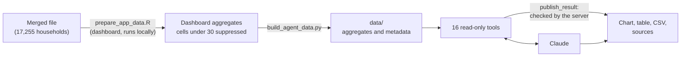

# WFP Chad data assistant

[](https://github.com/Abson-dev/wfp-chad-data-assistant/actions/workflows/tests.yml)

Ask, in English or French, how the WFP Chad resilience surveys were merged, what is wrong or fixed in them, what they show, and what WFP's assistance cost per household. Every answer comes with its table, a chart when it helps, a CSV download and the tool calls behind it.

> *How was rCSIBorrow merged across the rounds, and what was wrong with it?*
>
> *Which validation checks fail, and which data issues are still open?*
>
> *Quelles régions ont le plus souffert de chocs au cours des 12 derniers mois en 2023 ?*
>
> *What did WFP's assistance cost per household in the 2023 Annual survey, and how is it built?*

It is the AI companion of the [WFP Chad data merging repository](https://github.com/Abson-dev/WFP_Chad_Cost_Benefit_Analysis_data_merging), which merges 10 household survey rounds of WFP's Integrated Resilience Programme in Chad (the 2018 baseline to the 2023 annual survey, 17,255 households) for IFPRI's cost-benefit analysis, and adds the cost of WFP's assistance to each household (merged file v6, 670 columns). It reads the aggregates that the repository's dashboard already publishes. This repository holds code and documentation only. The survey data belong to WFP and are not here.

> **Status: tested offline, not yet with the live model.** The tools, the build, the web app and the security rules are tested, on invented data and on the real tables. The quality of the model's own answers is not: run [the evals](#test-it) before relying on it.

## Try it in two minutes

No survey data and no API key are needed to see the tools work on an invented dashboard. You need Python 3.11 or [conda](https://conda-forge.org/download/).

```bash
python -m venv .venv && source .venv/bin/activate    # Windows: .venv\Scripts\activate
pip install -r requirements.txt

python demo/make_demo_data.py                        # invented tables in demo_data/ (a few seconds)
export WFP_AGENT_DATA=demo_data                      # Windows PowerShell: $env:WFP_AGENT_DATA="demo_data"

python wfp_cli.py list
python wfp_cli.py trace_variable variable=rCSIBorrow
python wfp_cli.py get_merge_status module=Shocks
python wfp_cli.py rank_regions indicator=fcs_pb round_id=R10
```

To chat with it, set an [Anthropic API key](https://console.anthropic.com) as `ANTHROPIC_API_KEY` and run:

```bash
WFP_AGENT_ALLOW_UNLOCKED=true python web/app.py     # then open http://127.0.0.1:8011
```

Everything built from the invented dashboard is labelled synthetic, in the tools and in the web app.

## How it works



The dashboard's `prepare_app_data.R` is the only step that reads household data. `build_agent_data.py` reshapes its aggregates, adds the issue list, the module list and the indicator catalogue, and refuses to build if any table carries a household-level column. The model chooses which tools to call and which columns and chart type to show. It never sees a household record, writes no code that runs, and cannot change any file.

| Rule | How it is enforced |
|---|---|
| **No household data reaches the model** | The build reads only the dashboard's aggregates, and stops if a table has an identifying column (ID, village, GPS, interview date). The tools read only `data/`. Tests check every table. |
| **Small cells stay hidden** | Regional cells under 30 households are suppressed by the dashboard, and the tests check it. |
| **Numbers come from tools** | The instructions forbid estimating, and each answer lists its tool calls. |
| **Known defects are visible** | Every figure comes as merged and with the dashboard's indicative corrections, with a flag and its reason where a defect is known. |
| **Charts cannot mislead on season** | The server refuses a line joining the lean-season (PDM) rounds to the post-harvest rounds, a chart with duplicate rows, and non-numeric axes. |
| **Text from the model cannot run** | The browser inserts it as text; a strict Content-Security-Policy forbids outside scripts, and nothing is loaded from outside the app. |
| **Each question is bounded** | 12 tool rounds, 180 seconds and 500 rows, in [`limits.json`](limits.json). |
| **Access is controlled** | The app listens on this computer only by default, and refuses to start on a reachable host without a password. |

**Regional aggregates are sent to the Anthropic API when a question needs them. Agree this use with WFP before sharing the assistant.** Chat history stays in the user's browser and can quote regional values.

## Linked with the dashboard

The assistant and the [dashboard](https://abson-dev.shinyapps.io/wfp-chad-data-merging/) share their figures: `build_agent_data.py` reads the dashboard's aggregates, so rebuild the assistant's tables after each dashboard refresh. Each published result links back to the dashboard page that holds it (for example `#page=costs`), which opens after the dashboard's login. The dashboard's About page describes the assistant, and shows an "Ask the assistant" link once it is hosted (`WFP_ASSISTANT_URL` on the dashboard's server).

## Three ways to use it

| Way | Needs | For |
|---|---|---|
| **Web app**: `run_web.bat` (Windows) or `python web/app.py` | `ANTHROPIC_API_KEY` | Chat, charts, tables, CSV |
| **Command line**: `python ask.py "..."` | `ANTHROPIC_API_KEY` | One question, or interactive |
| **Skill**: [`skill/SKILL.md`](skill/SKILL.md) with `wfp_cli.py` | An assistant that loads skills, such as Claude Code | The same tools from the assistant you already use |

Anyone can run the tools directly with `python wfp_cli.py`, with no API key.

## What it can answer

| About | Tool | Gives |
|---|---|---|
| **The merge** | `trace_variable` | For a variable and each round: the source column, type, coverage, question and value labels, and the share of households whose merged value equals the raw one |
| | `describe_variable` | The distribution of a column of the merged file by round |
| | `search_variables` | Columns and workbook variables by name or label, in English or French, accents ignored |
| | `get_merge_status` | Each merge step (rows, matches, columns added), or the households a module reaches in each round |
| | `get_validation_checks`, `search_data_issues` | The dashboard's checks (pass, warn, fail) and the documented data issues |
| **The analysis** | `list_rounds`, `list_indicators`, `get_indicator`, `compare_rounds` | 55 indicators by round, national or by region, as merged and with corrections |
| | `rank_regions`, `relate_indicators` | Regions against all surveyed households; two indicators across regions, with correlations |
| **The programme** | `get_assistance`, `get_costs` | The WFP interventions households report; WFP's reconciled resilience costs (XAF) by period, activity, area and partner |
| **Costs per household** | `get_household_costs` | The 44 cost variables of the merged file as aggregates: by round (and the source of the community cost), by intervention, by asset type, by region; the ledger of the community template; the template against WFP's revised workbook; unit costs, exchange rates and the dictionary of the cost variables |
| **The reader** | `publish_result` | The checked table and chart under the answer |

**It cannot:** weight the figures, give confidence intervals or significance tests, go below the region, compute a new indicator, or see a household. Correlations describe regions, not households. Child (MAD) and women's (MDD-W) diet data are not in the merged file. It says so rather than guess.

## Use it on the real data

This needs the merging repository, its dashboard data and WFP's agreement.

1. **Environment.** `conda env create -f environment.yml`, then `conda activate wfp-agent`. The ENSA assistant's `ensa-agent` environment has the same packages and also works.
2. **API key**, from <https://console.anthropic.com>. Keep it out of files:
   ```powershell
   setx ANTHROPIC_API_KEY "sk-ant-..."     # Windows, then open a new terminal
   ```
3. **Dashboard data.** In the merging repository, run `app/prepare_app_data.R` after each new merged file. Keep that repository next to this folder, or set `WFP_DASHBOARD_APP` to its `app/` folder.
4. **Tables** (a few seconds; Rscript must be on the PATH to export the indicator catalogue):
   ```bash
   python build_agent_data.py
   ```
5. **Start**: `run_web.bat`, or `python web/app.py` with `WFP_AGENT_ALLOW_UNLOCKED=true`.

On a server, always set a password and put HTTPS in front of it: `APP_PASSWORD=... HOST=0.0.0.0 python web/app.py`.

| Setting | Default | Meaning |
|---|---|---|
| `ANTHROPIC_API_KEY` | none | Needed for the model |
| `APP_PASSWORD` | none | Password of the web app |
| `WFP_AGENT_ALLOW_UNLOCKED` | `false` | No password, on this computer only |
| `HOST`, `PORT` | `127.0.0.1`, `8011` | Where the web app listens |
| `WFP_AGENT_MODEL` | `claude-opus-5-5` | Model |
| `WFP_AGENT_EFFORT` | `high` | `low` to `max`; `medium` costs less and is often enough for look-ups |
| `WFP_AGENT_DATA` | `data/` | Folder of the tables |
| `WFP_DASHBOARD_URL` | `https://abson-dev.shinyapps.io/wfp-chad-data-merging/` | The dashboard each result links back to (`#page=...`); empty for no link |
| `WFP_DASHBOARD_APP` | `../WFP_Chad_Cost_Benefit_Analysis_data_merging/app` | The dashboard folder the build reads |

The instructions and tool definitions are cached between questions. `ask.py` prints the tokens used; see the [current prices](https://www.anthropic.com/pricing).

## Test it

```bash
pip install -r requirements-dev.txt
ruff check .
python -m pytest                       # invented dashboard: no data, no API key
WFP_TEST_REAL_DATA=1 python -m pytest  # the same on the real tables, plus 4 checks (your computer only)
python evals/run_evals.py --dry-run    # the eval questions and their expected values
python evals/run_evals.py              # asks the model each question and grades the answers (paid)
```

| Layer | What it checks | Model? |
|---|---|---|
| `tests/test_build.py` | Figures equal to the dashboard's, flags, suppression, the household-column guard | No |
| `tests/test_tools.py` | Every tool, including its error messages, and the command line | No |
| `tests/test_publish_and_loop.py` | Chart checks and the agent loop, through the real tools with [scripted replies](tests/scripted_model.py) | Scripted |
| `tests/test_web.py` | Streaming, password, sessions, limits, startup rule | Scripted |
| `tests/test_browser.py` | The client in real Chrome under the production security policy: every chart type, injected HTML, CSV, history, phone width | Scripted |
| `evals/run_evals.py` | 18 questions: the right number (± 0.15), the expected caveats, the right tools | **Live** |

Only the evals say how good the model's answers are. A full run makes paid API calls, once per question plus its tool rounds. Run them after any change to [the instructions](wfp_agent/system_prompt.md) or the tools.

## Repository

```
├── build_agent_data.py    dashboard aggregates -> data/ (refuses household-level columns)
├── ask.py                 command line: questions to the model
├── wfp_cli.py             command line: the tools, no API key
├── limits.json            limits per question and for the web app
├── run_web.bat            starts the web app on this computer
├── wfp_agent/
│   ├── tools.py           the read-only tools
│   ├── results.py         checks what is published
│   ├── system_prompt.md   the instructions: rounds, caveats, known defects, merging process, answer style
│   └── agent.py           tool loop, history, token counts
├── web/                   FastAPI server and browser client (Vega served locally)
├── skill/                 the same tools as a skill for any assistant
├── demo/                  the invented dashboard behind the demo and the tests
├── tests/, evals/         offline tests; live evals
└── data/, demo_data/      generated, not versioned
```

See also [CONTRIBUTING.md](CONTRIBUTING.md), [SECURITY.md](SECURITY.md) and [CHANGELOG.md](CHANGELOG.md). The design follows the [ENSA Chad data assistant](https://github.com/Abson-dev/ensa-chad-data-assistant) and [eurostat-assistant](https://github.com/ainergy-hub/eurostat-assistant).
